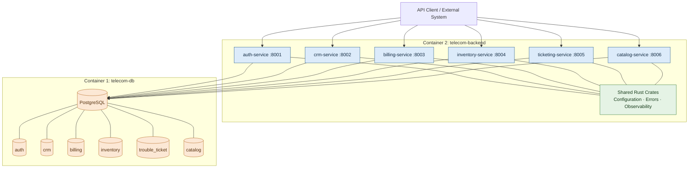

# Telecom Core Backend — Architecture

**File:** `docs/architecture.md`  
**Version:** 3.0  
**Status:** Proposed  
**Technology stack:** Rust, Axum, Tokio, SQLx, PostgreSQL  
**Architecture style:** Modular backend with logically independent services and schema-based data ownership

---

## 1. Purpose

This document defines the target architecture for the Telecom Core Backend, an enterprise-style telecom Business Support System (BSS) and Operations Support System (OSS) backend.

The system provides APIs for authentication, customer management, billing, commercial catalog, resource inventory, and trouble-ticket management.

The architecture must support:

- Clear service and domain boundaries.
- Secure, role-based access control.
- Reliable financial transactions and auditability.
- Independent database schema ownership.
- Automated testing and repeatable deployments.
- Future migration to independently deployed services if required.

This is a backend-only system. User interfaces and AI components are outside the scope of this architecture.

## 2. Architectural principles

1. **Two containers only:** one PostgreSQL container and one backend container.
2. **Logical service separation:** six services retain independent routes, domain logic, API contracts, database access, and tests.
3. **Schema ownership:** each service owns its PostgreSQL schema and controls its migrations.
4. **No cross-service writes:** a service must not directly modify another service's tables.
5. **API-based integration:** cross-service operations use documented APIs or explicitly approved integration mechanisms.
6. **Security by default:** enforce authentication, authorization, least privilege, and audit logging.
7. **Financial correctness:** use exact monetary representations, idempotency, immutable posted ledger entries, and compensating entries.
8. **Specification-driven development:** features require specifications, acceptance criteria, tests, and traceability.
9. **Observable execution:** use structured logs, metrics, and distributed tracing where applicable.
10. **No unsupported compliance claims:** telecom standards compliance must be established through explicit requirements and verification.

## 3. High-level architecture

**Deployment clarification:** the six service boxes represent logical services, not six Docker containers. The backend container hosts all six service processes. The PostgreSQL container hosts the database and its six schemas.

The shared Rust crates provide reusable infrastructure; they must not merge the services' business responsibilities.
