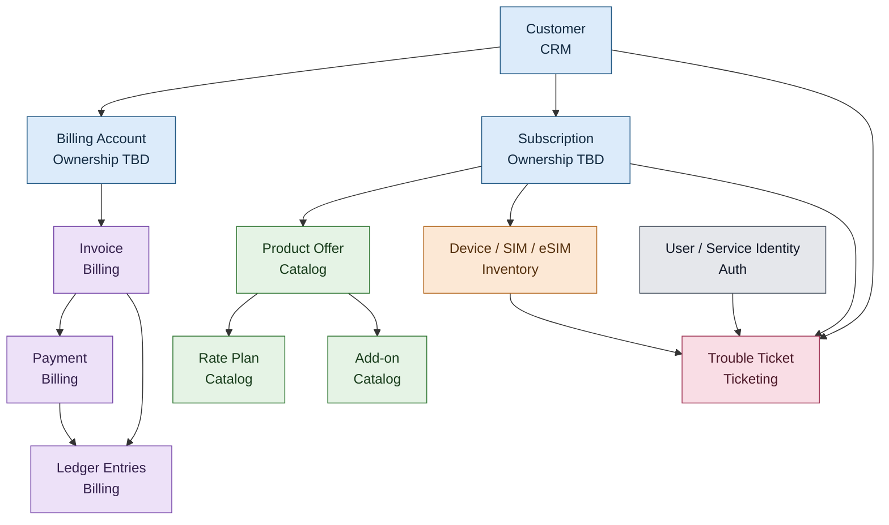

# Telecom Core Backend — Domain Model

**File:** `docs/domain-model.md`  
**Version:** 1.0  
**Status:** Proposed — ownership decisions require review  
**Stack:** Rust, Axum, SQLx, PostgreSQL  
**Methodology:** Spec-Driven Development (SDD)

## 1. Purpose

This document defines the business entities, relationships, ownership boundaries, and invariants for the Telecom Core Backend.

It serves as the reference for:

- PostgreSQL schema design and migrations.
- Rust domain models and validation.
- API contracts.
- Integration workflows.
- Automated tests and acceptance criteria.
- Architecture decision records (ADRs).

The model is a proposed baseline. Entity ownership and business rules marked as open must be resolved before implementing dependent features.

## 2. Domain boundaries

The system has six logical services.

| Service | Port | Schema | Primary responsibility |
|---|---:|---|---|
| Auth | 8001 | `auth` | Identity, roles, permissions |
| CRM | 8002 | `crm` | Customers and customer relationships |
| Billing | 8003 | `billing` | Invoices, payments, ledger |
| Inventory | 8004 | `inventory` | Devices, SIM/eSIM, assignments |
| Ticketing | 8005 | `trouble_ticket` | Trouble tickets and event history |
| Catalog | 8006 | `catalog` | Products, offers, rate plans, add-ons |

All six services run inside `telecom-backend`. They share the PostgreSQL instance in `telecom-db`, but they retain separate business responsibilities and schema ownership.

**Ownership rule:** each business entity has one authoritative owner. Other services access its information through documented APIs or approved integration contracts, not direct writes to its tables.

## 3. High-level domain relationships

Subscription and billing-account ownership remain unresolved.

## 4. Shared modeling conventions

### 4.1 Identifiers
Use UUIDs for primary identifiers. Do not use mutable business attributes as permanent primary keys.

### 4.2 Timestamps
Store timestamps as `TIMESTAMPTZ` in UTC. Distinguish creation, update, effective, and business-event times.

### 4.3 Status values
Use explicit enums/validated status types with documented transition rules.

### 4.4 Monetary values
Use `rust_decimal::Decimal` or integer minor units with explicit currency. Never use floating point for money.

### 4.5 Cross-service identifiers
Store external references as UUIDs; validate via APIs/contracts. Cross-schema foreign keys require approved ADR.

## 5. Auth domain (auth)

Owner: `auth-service` (schema `auth`)

Entities: `users`, `roles`, `permissions`, `user_roles`, `role_permissions`, `service_identities`. Passwords hashed with Argon2id; tokens validated strictly.

## 6. CRM domain (crm)

Owner: `crm-service` (schema `crm`)

Entities: `customers`, `customer_addresses`. Customer billing-account relationship ownership TBD.

## 7. Catalog domain (catalog)

Owner: `catalog-service` (schema `catalog`)

Entities: `products`, `product_offers`, `rate_plans`, `rate_plan_versions`, `add_ons`, `offer_components`. Owns commercial definitions and effective-dated terms.

## 8. Inventory domain (inventory)

Owner: `inventory-service` (schema `inventory`)

Entities: `devices`, `sim_cards`, `esim_profiles`, `resource_assignments`, `resource_status_history`. Prevents conflicting assignments; tracks lifecycle/history.

## 9. Billing domain (billing)

Owner: `billing-service` (schema `billing`)

Entities: `billing_accounts` (TBD ownership), `invoices`, `invoice_line_items`, `payments`, `payment_allocations`, `credit_memos`, `ledger_entries`, `reconciliation_records`. Posted ledger entries immutable; corrections via compensating entries; exact decimal arithmetic; idempotency required.

## 10. Trouble-ticketing domain (trouble_ticket)

Owner: `ticketing-service` (schema `trouble_ticket`)

Entities: `tickets`, `ticket_comments`, `ticket_events`. Enforces state-transition matrix; internal comments access-controlled; events auditable.

## 11. Subscription and order ownership (Open)

Subscriptions/orders ownership unresolved (CRM vs separate service). Do not implement until decision approved.

## 12. Cross-domain relationships and integrity

Same-schema FKs preferred. Cross-schema FKs require ADR. Validate cross-service references via APIs/contracts.

