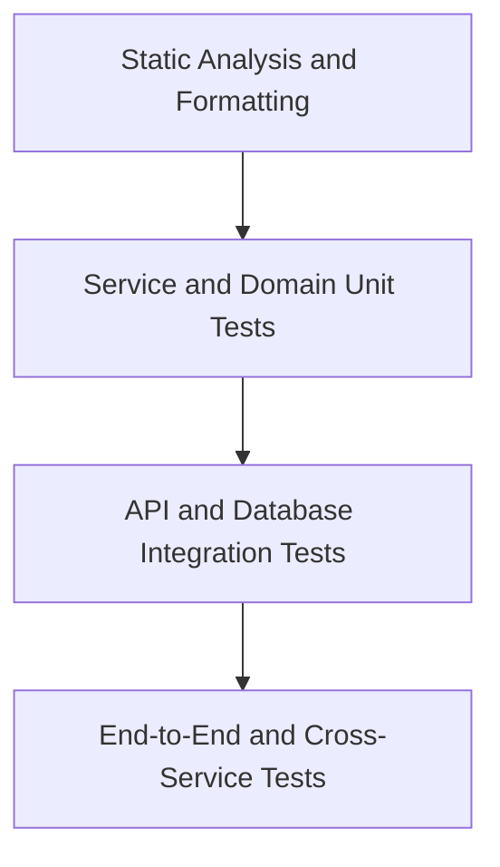

# Test Strategy

**Version:** 1.0  
**Status:** Draft — subject to architecture decisions  
**Project:** Telecom Core Backend  
**Stack:** Rust, Axum, Tokio, SQLx, PostgreSQL  
**Architecture:** Six logical backend services, one backend container, one PostgreSQL container

---

## 1. Purpose

This document defines how we verify the correctness, security, reliability, and maintainability of the Telecom Core Backend.

Testing is part of Spec-Driven Development (SDD). Every feature must have a specification, acceptance criteria, tests, and traceability to its implementation.

The strategy focuses on:

- Business-rule correctness.
- Service and database boundaries.
- API contracts.
- Authentication and authorization.
- Financial integrity and transaction safety.
- Cross-service integration.
- Database migrations.
- Observability and operational reliability.

## 2. Testing Principles

1. **Specification first:** define expected behavior before implementation.
2. **Test observable behavior:** prioritize public contracts and business outcomes.
3. **Test at the lowest effective layer:** use unit tests for domain rules and integration tests for persistence.
4. **Test negative cases:** invalid input, insufficient permissions, missing resources, conflicts, and failures.
5. **Protect financial integrity:** verify idempotency, concurrency, exact monetary calculations, and immutable posted entries.
6. **Isolate service ownership:** verify that one service cannot bypass another service's domain rules.
7. **Use deterministic data:** tests must not depend on production data or uncontrolled external services.
8. **Automate quality gates:** required checks must run in CI before merging.
9. **Maintain traceability:** map requirements and acceptance criteria to automated tests.
10. **Keep runtime architecture unchanged:** tests must not introduce additional production containers.

## 3. Test Pyramid



- **Static checks:** detect formatting, linting, and dependency issues.
- **Unit tests:** verify domain logic without a database or network.
- **Integration tests:** verify PostgreSQL behavior, SQL queries, migrations, and API handlers.
- **End-to-End tests:** verify complete workflows across multiple logical services.

## 4. Test Levels

### 4.1 Static analysis and code quality
```bash
cargo fmt --all -- --check
cargo clippy --workspace --all-targets --all-features -- -D warnings
cargo test --workspace
cargo audit
cargo deny check
```

### 4.2 Unit tests
Verify isolated Rust functions, domain objects, and business rules. No database or network required.

### 4.3 Database integration tests
Use SQLx with disposable test database. Test migrations, constraints, transactions, permissions, and data isolation.

### 4.4 API contract tests
Test each service via HTTP on ports 8001-8006. Verify authn/authz, validation, errors, pagination, OpenAPI consistency.

### 4.5 Cross-service integration tests
Verify workflows across multiple services. Must use documented APIs/contracts, no direct cross-schema writes.

## 5. Security and Authorization Testing
Test authn, RBAC (AGENT/SUPERVISOR/service identities), least privilege, input validation, and sensitive data protection.

## 6. Financial Integrity Testing
Test monetary precision, ledger immutability, compensating entries, idempotency, concurrency, and reconciliation.

## 7. Database Migration Testing
Test fresh init, apply all migrations, failure handling, permissions, constraints, rollback/forward recovery.

## 8. Test Data and Fixtures
Use synthetic deterministic data. Isolate per test, no production data. See `docs/synthetic-data.md` for the per-schema generation rules, scenarios, and configuration.

## 9. Observability and Reliability Testing
Test correlation IDs, structured logging (no secrets), metrics, health/readiness, graceful shutdown, dependency failures.

## 10. Performance Testing
Measure latency, throughput, errors, DB pool usage, locks. Run in isolated environment.

## 11. CI Pipeline
Stages: format → clippy → unit → security/dependency → postgres + migrations/integration → API → authz/security → cross-service → build docker → validate config → publish results.

## 12. Requirements-to-Test Traceability
Maintain traceability matrix linking requirements, acceptance criteria, and tests.

## 13. Definition of Test Completion
Requirements, positive/negative cases, authz, migrations, API contracts, invariants (where applicable), CI passing, gaps documented, traceability updated.

## 14. Open Decisions
Resolve ownership (subscriptions/orders), ledger model, currencies/tax/rounding, auth mechanism/token lifecycle, integration patterns, targets, migration recovery, CI environment.

## 15. Initial Implementation Order
1. Workspace tooling/tests
2. Disposable Postgres integration
3. Migrations/permissions
4. API contract tests
5. AuthN/AuthZ
6. Billing/inventory integrity
7. Cross-service workflows
8. Performance/failure/ops tests
